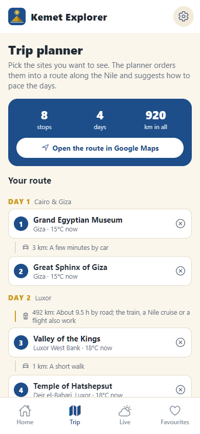
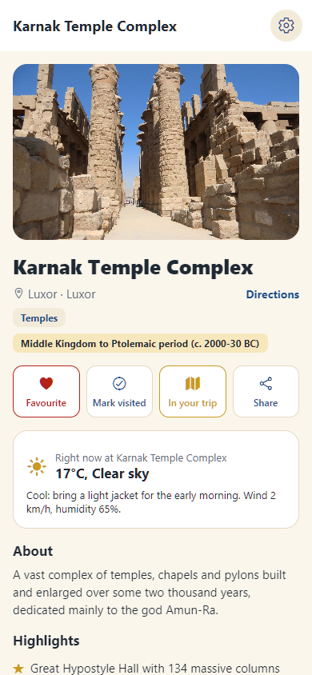
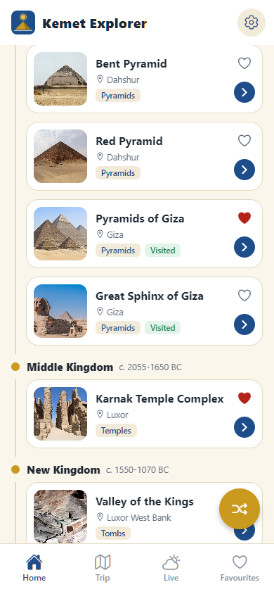
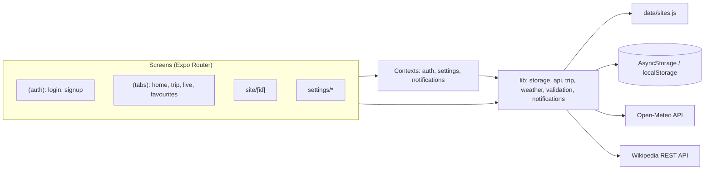

# Kemet Explorer

[](https://github.com/engomaressam/kemet-explorer/actions/workflows/ci.yml)

A cross-platform mobile guide to 23 of Egypt's ancient sites and museums, built with React Native and Expo. Users create an account (or open the demo), browse the sites as a list or as a timeline, open a detail page with live weather and a Wikipedia summary, save favourites, plan a route along the Nile, track the sites they have visited and get a daily discovery reminder. The same code runs on iOS, Android and the web.

**Try it in the browser: [engomaressam.github.io/kemet-explorer](https://engomaressam.github.io/kemet-explorer/)**, then tap *Try the demo, no sign-up*. The demo account starts with a few saved sites and a planned trip; everything stays in your browser.

It began as the capstone project for the IBM iOS and Android Mobile App Developer Professional Certificate. Version 1.1 goes beyond the course brief: a trip planner, a timeline view, a demo account, eleven more sites, unit tests, continuous integration and a deployed web version.

| Home | Trip planner | Detail | Timeline | Live weather |
|---|---|---|---|---|
|  |  |  |  |  |

## Features

| Area | What it does | Code |
|---|---|---|
| Registration and login | Username, email and password with validation and clear messages; duplicate accounts refused; passwords stored as salted SHA-256 hashes; session kept until logout | [signup.js](src/app/%28auth%29/signup.js), [login.js](src/app/%28auth%29/login.js), [AuthContext.js](src/context/AuthContext.js), [validation.js](src/lib/validation.js) |
| Demo account | One tap from the login screen opens a demo account with saved favourites, visits and a trip, so visitors can look around without signing up | [AuthContext.js](src/context/AuthContext.js) |
| Home | Greeting, progress cards, search, category chips (pyramids, temples, tombs, museums), site of the day, "surprise me" button; list or timeline view grouped by historical period | [home.js](src/app/%28tabs%29/home.js), [SiteCard.js](src/components/SiteCard.js), [sites.js](src/data/sites.js) |
| Trip planner | Orders the chosen sites into a route along the Nile, with the distance and a rough travel time for each leg, suggested days, live weather at each stop and the whole route in Google Maps | [trip.js (screen)](src/app/%28tabs%29/trip.js), [trip.js (logic)](src/lib/trip.js) |
| Detail | Photo, facts, era, favourite, visited, add-to-trip and share actions, directions in Google Maps, live weather, highlights, Wikipedia summary, related sites | [src/app/site/[id].js](src/app/site/%5Bid%5D.js) |
| External APIs | Open-Meteo current weather and daily forecast for every site in one request; Wikipedia REST summaries and photos; loading, error and cached states | [api.js](src/lib/api.js), [live.js](src/app/%28tabs%29/live.js), [weather.js](src/lib/weather.js) |
| Local storage | Accounts, session, favourites, visited sites, trip, settings, notification history, activity log and API caches in AsyncStorage (localStorage on the web) | [storage.js](src/lib/storage.js), [settings/storage.js](src/app/settings/storage.js) |
| Settings | Gear icon on every main screen; dark mode, text size, temperature unit, default category, sort order, photo loading; profile and password changes | [settings/index.js](src/app/settings/index.js), [preferences.js](src/app/settings/preferences.js), [account.js](src/app/settings/account.js) |
| Notifications | Permission handling, daily reminder at a chosen time, heat alerts for favourite sites, test notification, history | [notifications.js](src/lib/notifications.js), [settings/notifications.js](src/app/settings/notifications.js) |
| Web version | Deployed to GitHub Pages by CI; deep links such as `/site/karnak` work; installable as a web app; link previews for sharing | [ci.yml](.github/workflows/ci.yml), [public/](public/) |

The user stories behind the first version are in [KemetExplorer_user_stories.md](KemetExplorer_user_stories.md), and the wireframes are in [design/](design/).

## How it is built



- **Navigation:** Expo Router turns each file in `src/app` into a route: a root stack, an auth group and a bottom-tab group. Signed-out users are redirected to the login screen.
- **State:** three React contexts hold the signed-in user, their settings (theme, units, text size) and notifications. Screens read saved data from `src/lib/storage.js` when they gain focus, so every tab stays in step.
- **Data:** the site catalogue is local (facts, coordinates, era); live data comes from Open-Meteo and Wikipedia and is cached for 15 minutes and 7 days.

### The trip planner

[`src/lib/trip.js`](src/lib/trip.js) has no React Native imports, so it is unit-tested in Node:

1. **Distances** are great-circle distances (haversine formula) between the sites' coordinates.
2. **Route:** two first drafts, nearest neighbour from the northernmost stop and plain north-to-south order, are each improved with **2-opt** (reverse any segment whose reversal shortens the route, until none does), and the shorter result wins. Starting from two drafts avoids the poor local optimum that 2-opt can reach from a greedy start; a test checks the result is never longer than the north-to-south order.
3. **Days:** up to three stops a day, and a new day after any leg of 150 km or more.
4. **Travel time** is a rough road estimate (straight-line distance stretched by a third, at 70 km/h); long legs suggest the train, a Nile cruise or a flight.

## Tech stack

- Expo SDK 58, React Native 0.88, React 19, react-native-web
- Expo Router (file-based navigation)
- @react-native-async-storage/async-storage for persistence
- expo-notifications for scheduled local notifications on iOS and Android; the browser Notification API on the web
- expo-crypto for password hashing
- @expo/vector-icons (Ionicons)
- Node's built-in test runner for unit tests; GitHub Actions and GitHub Pages for CI and the web version

## Run it

You need Node.js 22.13 or later (see `.nvmrc`).

```bash
git clone https://github.com/engomaressam/kemet-explorer.git
cd kemet-explorer
npm ci
npx expo start
```

Then press `w` for the web version, `a` for an Android emulator or `i` for the iOS simulator, or scan the QR code with Expo Go on a phone. Scheduled notifications need a phone or a development build; on the web they are delivered while the app is open, after the browser asks for permission.

| Command | What it does |
|---|---|
| `npm test` | Runs the unit tests |
| `npm run build:web` | Builds the web version into `dist/` (served from `/kemet-explorer`, as on GitHub Pages) |

## Tests and CI

22 unit tests ([tests/](tests/)) use Node's built-in `node:test`, with no extra dependencies:

- **validation:** email, username, password and the whole sign-up form;
- **weather:** weather-code labels, Celsius and Fahrenheit, visiting tips;
- **trip planner:** haversine distances, routes that visit every stop once, 2-opt never worse than north-to-south order, day splitting, leg labels, the Google Maps link;
- **catalogue:** required fields, unique ids, categories, coordinates inside Egypt, photo URLs, period grouping.

[GitHub Actions](.github/workflows/ci.yml) runs the tests and builds the web version on every push and pull request; pushes to `main` also deploy the build to GitHub Pages.

## Project structure

```
src/
  app/                  Expo Router screens
    _layout.js          providers and the root stack
    index.js            redirects to /home or /login
    (auth)/             login.js, signup.js
    (tabs)/             home.js, trip.js, live.js (weather API), favorites.js
    site/[id].js        detail screen
    settings/           index.js (menu), preferences.js, account.js,
                        notifications.js, storage.js, about.js
  components/           shared UI, site card, notification banner
  constants/theme.js    light and dark palettes, spacing, font scale
  context/              auth, settings and notification providers
  data/sites.js         the 23 sites and the historical periods
  lib/                  storage, validation, API, weather, trip planner
                        and notification helpers
tests/                  unit tests (node:test)
public/                 web page template, manifest, icons, link preview image
design/                 wireframe SVG frames (import into Figma) and boards
docs/screenshots/       screenshots used in this README
.github/workflows/      CI and GitHub Pages deployment
```

## Stored data

| Key | Contents |
|---|---|
| `kemet:users` | Registered accounts (username, email, salt, password hash, created date) |
| `kemet:session` | The signed-in user and login time |
| `kemet:favorites:<userId>` | Favourite site ids |
| `kemet:visited:<userId>` | Visited site ids |
| `kemet:trip:<userId>` | Site ids chosen for the trip planner |
| `kemet:settings:<userId>` | Theme, text size, units, home-screen and notification preferences |
| `kemet:notifications:<userId>` | Recent notifications |
| `kemet:activity:<userId>` | Activity log (sign-up, logins, views, favourites, settings changes) |
| `kemet:cache:weather`, `kemet:cache:wiki` | Cached API responses (15 minutes and 7 days) |

Everything stays on the device. Settings > Privacy & stored data lists the keys and can clear the caches.

## Limitations

- There is no server: accounts exist only on the device or browser where they were made. The salted hashes keep passwords out of plain sight in storage, but a production app would authenticate against a backend.
- Trip distances are straight lines and travel times are rough estimates; opening hours and transport are not covered.
- Scheduled notifications need a phone or a development build.

## Data sources

- Weather: [Open-Meteo](https://open-meteo.com/) (free, no API key, CC BY 4.0)
- Summaries, photos and coordinates: [Wikipedia REST API](https://en.wikipedia.org/api/rest_v1/) and Wikimedia Commons (CC BY-SA)

## Licence

MIT. See [LICENSE](LICENSE).
