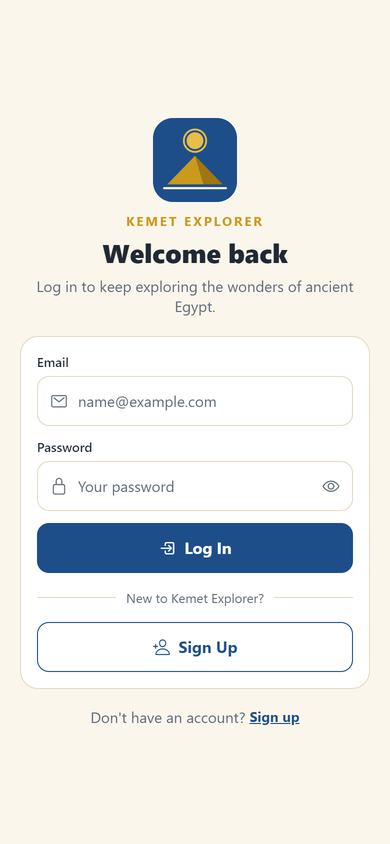
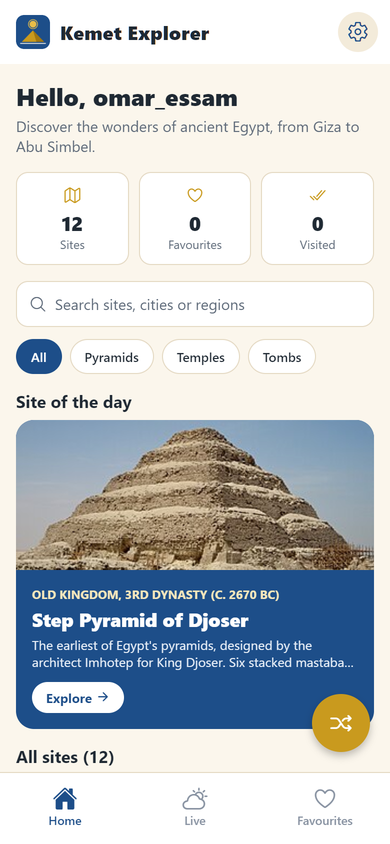
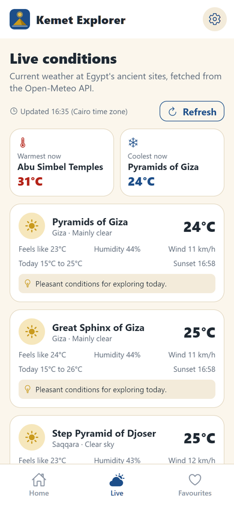
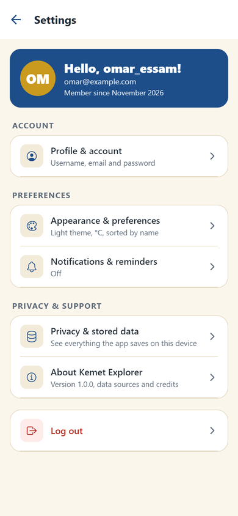

# Kemet Explorer

A cross-platform mobile guide to twelve of Egypt's great ancient sites, built with React Native and Expo. Users create an account, browse and search the sites, open a detail page for each one, save favourites, track the sites they have visited, check live weather at every site and get a daily discovery reminder.

It is the capstone project for the IBM iOS and Android Mobile App Developer Professional Certificate. The same code runs on iOS, Android and the web.

| Login | Home | Detail | Live weather | Settings |
|---|---|---|---|---|
|  |  |  |  |  |

## Features

| Area | What it does | Code |
|---|---|---|
| Registration | Username, email and password with validation; duplicate accounts refused; passwords stored as salted SHA-256 hashes | [src/app/(auth)/signup.js](src/app/%28auth%29/signup.js), [src/context/AuthContext.js](src/context/AuthContext.js), [src/lib/validation.js](src/lib/validation.js) |
| Login | Email and password, clear error messages, session kept until logout | [src/app/(auth)/login.js](src/app/%28auth%29/login.js) |
| Home | Logo header, greeting, progress cards, search, category chips, site of the day, site list with navigation icons, "surprise me" button | [src/app/(tabs)/home.js](src/app/%28tabs%29/home.js), [src/components/SiteCard.js](src/components/SiteCard.js) |
| Detail | Photo, facts, era, favourite, visited and share actions, live weather, highlights, Wikipedia summary, related sites | [src/app/site/[id].js](src/app/site/%5Bid%5D.js) |
| Local storage | Accounts, session, favourites, visited sites, settings, notification history, activity log and API caches in AsyncStorage (localStorage on the web) | [src/lib/storage.js](src/lib/storage.js), [src/app/settings/storage.js](src/app/settings/storage.js) |
| External APIs | Open-Meteo current weather and daily forecast for all sites in one request; Wikipedia REST summaries and photos; loading, error and cached states | [src/lib/api.js](src/lib/api.js), [src/app/(tabs)/live.js](src/app/%28tabs%29/live.js) |
| Settings menu | Gear icon on every main screen; grouped menu with a personalised header and logout | [src/app/settings/index.js](src/app/settings/index.js), [src/components/ui.js](src/components/ui.js) |
| Settings screen | Dark mode, text size, temperature unit, default category, sort order, photo loading, reset; profile and password changes | [src/app/settings/preferences.js](src/app/settings/preferences.js), [src/app/settings/account.js](src/app/settings/account.js), [src/context/SettingsContext.js](src/context/SettingsContext.js) |
| Notifications | Permission handling, master switch, daily reminder at a chosen time, heat alerts for favourite sites, test notification, history | [src/lib/notifications.js](src/lib/notifications.js), [src/app/settings/notifications.js](src/app/settings/notifications.js), [src/context/NotificationContext.js](src/context/NotificationContext.js) |

The user stories behind these features are in [KemetExplorer_user_stories.md](KemetExplorer_user_stories.md), and the wireframes are in [design/](design/).

## Tech stack

- Expo SDK 58, React Native 0.88, React 19
- Expo Router (file-based navigation: a root stack, an auth group and a bottom-tab group)
- @react-native-async-storage/async-storage for persistence
- expo-notifications for scheduled local notifications on iOS and Android; the browser Notification API on the web
- expo-crypto for password hashing
- @expo/vector-icons (Ionicons)

## Run it

You need Node.js 20 or later.

```bash
git clone https://github.com/engomaressam/kemet-explorer.git
cd kemet-explorer
npm install
npx expo start
```

Then press `w` for the web version, `a` for an Android emulator or `i` for the iOS simulator, or scan the QR code with Expo Go on a phone. Scheduled notifications need a phone or a development build; on the web they are delivered while the app is open, after the browser asks for permission.

## Project structure

```
src/
  app/                  Expo Router screens
    _layout.js          providers and the root stack
    index.js            redirects to /home or /login
    (auth)/             login.js, signup.js
    (tabs)/             home.js, live.js (weather API), favorites.js
    site/[id].js        detail screen
    settings/           index.js (menu), preferences.js, account.js,
                        notifications.js, storage.js, about.js
  components/           shared UI, site card, notification banner
  constants/theme.js    light and dark palettes, spacing, font scale
  context/              auth, settings and notification providers
  data/sites.js         the twelve sites
  lib/                  storage, validation, API and notification helpers
design/                 wireframe SVG frames (import into Figma) and boards
docs/screenshots/       screenshots used in this README
```

## Stored data

| Key | Contents |
|---|---|
| `kemet:users` | Registered accounts (username, email, salt, password hash, created date) |
| `kemet:session` | The signed-in user and login time |
| `kemet:favorites:<userId>` | Favourite site ids |
| `kemet:visited:<userId>` | Visited site ids |
| `kemet:settings:<userId>` | Theme, text size, units, home-screen and notification preferences |
| `kemet:notifications:<userId>` | Recent notifications |
| `kemet:activity:<userId>` | Activity log (sign-up, logins, views, favourites, settings changes) |
| `kemet:cache:weather`, `kemet:cache:wiki` | Cached API responses (15 minutes and 7 days) |

Everything stays on the device. Settings > Privacy & stored data lists the keys and can clear the caches.

## Data sources

- Weather: [Open-Meteo](https://open-meteo.com/) (free, no API key, CC BY 4.0)
- Summaries and photos: [Wikipedia REST API](https://en.wikipedia.org/api/rest_v1/) (CC BY-SA)

## Licence

MIT. See [LICENSE](LICENSE).
